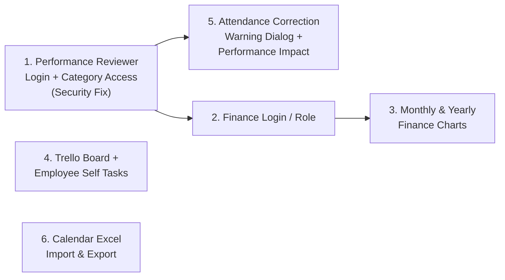

# EMS — New Feature Requirements

> Derived from the handwritten requirement notes (2 pages) and audited directly against the current codebase (`backend/` Django + `frontend/` Flutter, commit `8dd1f3c`).
>
> **Core Principle:** All existing Super Admin / Org Admin / HR / Employee workflows remain intact; these features extend the system and close existing permission gaps without breaking current functionality.

---

## Summary Overview

| # | Feature | Handwritten Page | Module(s) | Current Codebase State | Priority |
|---|---|---|---|---|---|
| 1 | **Separate Performance Reviewer Login** with Admin-controlled **category access** & **no self-review** | Page 1 | `performance`, `authentication`, `router`, `app_shell` | ⚠️ Admin gives all reviews & toggles visibility; **bug**: `POST /api/performance/reviews/` has no role, category, or self-review check | 🔴 High (Security + Feature) |
| 2 | **Separate Finance Login / Role** for all salary & payroll operations | Page 1 | `salary_management`, `fiscal_year`, `authentication`, `accounts`, `salary` | ❌ No `is_finance` role; only `is_superuser`, `is_hr`, and `org.admin_users` | 🟠 Medium |
| 3 | **Monthly & Yearly Finance Charts** (inside Finance login & Admin Accounts) | Page 1 *(linked to #2)* | `salary_management`, `accounts` | ⚠️ `fl_chart: ^0.68.0` installed; `AccountsScreen` has 3 tabs (Payroll, Tax Bands, Audit CSV) but **no visual charts** | 🟠 Medium |
| 4 | **Trello-Style Task Cards & Employee Self-Created Tasks** (with progress logs & updates) | Page 2 *(Employee)* | `task_management`, `tasks` | ❌ Create FAB is admin-only; both task list & detail querysets require `project__in=projects` (project-less tasks vanish / 404) | 🟠 Medium |
| 5 | **Attendance Correction Warning Dialog** ("multiple corrections reduce performance") + optional performance link | Page 2 *(Employee)* | `attendance`, `performance`, `organization` | ❌ `CorrectionRequestListCreateAPIView` does not count monthly corrections or warn the employee | 🟡 Low–Medium |
| 6 | **Calendar Events Excel Export & Import** (`.xlsx`) | Page 2 *(Employee / Admin)* | `calendar_app`, `calendar` | ❌ No Excel export/import (`openpyxl` not yet in `requirements.txt`; `file_picker` already installed on frontend) | 🟡 Low |
| — | ~~Finance TDS Monthly and Yearly~~ | Page 1 *(crossed out)* | `salary_management` | Already calculated per transaction via `SalaryTaxBand` / `IncentiveTaxBand` / `BonusTaxBand` (and can be charted inside #3) | Crossed out |

---

## 1. Separate Performance Reviewer Login (Category-Controlled + No Self-Review)

### From the Handwritten Notes (Page 1)
> *"Performance xutaii Logic / Login. Two wota account — Euta Employee, and Performance — Self chaii (Performance) dina na milni. And admin le chaii control kun kun performance dini bhanera."* *(Note: "Eutaii ... role" is crossed out — intentionally **two separate accounts**, not one shared role.)*

**What this means:**
- **Keep existing Admin & Employee behavior untouched:**
  - Super Admin / Org Admin continues to manage categories, give performance reviews across all categories, and control `OrganizationSettings.enable_daily_performance`.
  - Employees continue to view reviews about themselves (when enabled by admin) and post replies.
- **Add a separate Performance Reviewer login/account:**
  - A reviewer has a dedicated login (if they are also a staff member, they have **two separate accounts**: one Employee account and one Performance Reviewer account).
  - **Admin controls which `PerformanceCategory`(ies)** each Performance Reviewer account is allowed to score.
  - **No self-review:** Even when a reviewer uses a separate Performance account, they **cannot** give a performance score to their own Employee profile.

### Example
| Reviewer Login | Linked Employee (excluded from self-review) | Admin-Assigned Categories | Can Score |
|---|---|---|---|
| `qa.perf@omway.com` | Sita K. *(optional)* | Code Quality, Testing | Only **Code Quality** & **Testing** for any employee except Sita K. |
| `hr.perf@omway.com` | Ram B. *(optional)* | Punctuality, Discipline | Only **Punctuality** & **Discipline** for any employee except Ram B. |
| `ext.reviewer@omway.com` | *(None — external/non-employee)* | Delivery, Teamwork | Only **Delivery** & **Teamwork** for all org employees |
| Super Admin / Org Admin | — | All categories (implicit) | Full existing control (unchanged) |

### Current Codebase Audit
- [backend/performance/views.py](../backend/performance/views.py):
  - `PerformanceCategoryViewSet` already restricts create/update/destroy to `_is_admin` (`is_superuser`, `user.organization.exists()`, `is_hr`). ✅
  - `PerformanceReviewListCreateView.perform_create()` (line 125) **only** calls `check_performance_enabled(user)` and saves `reviewer=request.user` — **missing role check, category permission check, and self-review block** (any employee can currently `POST /api/performance/reviews/` for anyone, including themselves).
  - `PerformanceReviewRetrieveUpdateDestroyView` checks `is_admin` for full org queryset; needs reviewer-scoped update/delete rules.
- [backend/performance/models.py](../backend/performance/models.py): `PerformanceReview.category` is `null=True, blank=True`. No reviewer-access model exists.
- [backend/authentication/models.py](../backend/authentication/models.py): `Account` has only `is_staff`, `is_active`, `is_superuser`, `is_hr`.
- [backend/authentication/api/serializers.py](../backend/authentication/api/serializers.py): `MeSerializer.get_role()` returns `'super_admin' | 'hr' | 'org_admin' | 'employee'`; `get_has_approved_policy()` must return `True` for standalone reviewer accounts.
- [frontend/lib/features/performance/screens/performance_screen.dart](../frontend/lib/features/performance/screens/performance_screen.dart): uses `user.canManage` to show Review + Categories tabs and inline category creation, and fetches `/api/organization/employees/` (line 1621) for the employee dropdown.

### Requirements
**Admin (existing + new management)**
1. Keep all existing Admin capabilities (create/edit/delete categories, review any employee in any category, view all org reviews).
2. Create a **Performance Reviewer account** (email, name, password), optionally link it to an `Employee` (`linked_employee`, to block self-review when one person holds two accounts), and select **which `PerformanceCategory`(ies)** they can review via checkboxes.
3. Edit a reviewer's assigned categories, change `linked_employee`, or deactivate/delete the reviewer account at any time.
4. Filter reviews by reviewer and by category.

**Performance Reviewer (separate login)**
1. Logs in via the standard login screen; routed to a dedicated **Performance Reviewer shell** (Performance, Notifications, Profile — no access to Attendance, Leave, Salary, Employees, Tasks, Projects, or Settings).
2. **Category is required** when submitting a review; dropdown lists **only their admin-assigned categories** (cannot create/edit/delete categories).
3. Employee dropdown lists org employees **excluding themselves** (both own `user_id` and `linked_employee`).
4. Can view reviews **only in their assigned categories** (scoped to their organization).
5. Can edit or delete **only reviews they themselves created** (`reviewer == request.user`).
6. Retains access even if `enable_daily_performance` is turned off for employees (same as admins).

**Employee (existing, security hardened)**
1. Unchanged: views reviews about themselves (when `enable_daily_performance` is enabled) and submits replies via `POST /api/performance/reviews/<pk>/reply/`.
2. **Blocked (`403`)** from `POST /api/performance/reviews/` (cannot review self or others from Employee login).

### Access Matrix (Backend-Enforced)
| Action | Super Admin / Org Admin / HR | Performance Reviewer | Employee |
|---|---|---|---|
| Manage categories (CRUD) | ✅ | ❌ | ❌ |
| Manage reviewer accounts & category access | ✅ | ❌ | ❌ |
| Give a performance score | ✅ Any category | ✅ **Assigned categories only** | ❌ (`403`) |
| Score self (same `user` OR `linked_employee`) | ❌ Blocked | ❌ Blocked | ❌ (`403`) |
| View reviews | All in org | Assigned categories in org | Own reviews only |
| Edit / delete a review | Any in org | Own given reviews only | ❌ (`403`) |
| Reply to a review | — | — | ✅ Own reviews |

### Proposed Technical Design
**Backend**
- [backend/authentication/models.py](../backend/authentication/models.py): add `is_performance_reviewer = models.BooleanField(default=False, null=True, blank=True)`.
- [backend/performance/models.py](../backend/performance/models.py):
  ```python
  class PerformanceReviewerAccess(models.Model):
      organization = models.ForeignKey(
          Organization, on_delete=models.CASCADE, related_name='performance_reviewers'
      )
      reviewer = models.OneToOneField(
          Account, on_delete=models.CASCADE, related_name='performance_access'
      )
      # Optional: link if this reviewer also has a separate Employee login (blocks self-review)
      linked_employee = models.ForeignKey(
          Employee, on_delete=models.SET_NULL, null=True, blank=True,
          related_name='reviewer_accounts'
      )
      categories = models.ManyToManyField(
          PerformanceCategory, blank=True, related_name='reviewers'
      )
      is_active = models.BooleanField(default=True)
      created_at = models.DateTimeField(auto_now_add=True)
  ```
- [backend/performance/views.py](../backend/performance/views.py) (`perform_create`):
  - Resolve `access = getattr(request.user, 'performance_access', None)`.
  - Block self-review if `employee.user_id == request.user.id` **or** `(access and access.linked_employee_id == employee.id)`.
  - If not admin: require `request.user.is_performance_reviewer and access and access.is_active`, require `category` not `None`, and verify `access.categories.filter(pk=category.pk).exists()`.
- New API routes under `/api/performance/`:
  - `GET / POST /api/performance/reviewers/` (Admin only) — list / create reviewer account + `PerformanceReviewerAccess`
  - `PATCH / DELETE /api/performance/reviewers/<pk>/` (Admin only) — update assigned `category_ids`, `linked_employee`, `is_active`, or remove
  - `GET /api/performance/my-categories/` (Reviewer / Admin) — allowed categories for review form
  - `GET /api/performance/reviewable-employees/` (Reviewer / Admin) — org employees excluding self & `linked_employee` (so Reviewer does not need broad `/api/organization/employees/` access)
- [backend/authentication/api/serializers.py](../backend/authentication/api/serializers.py): `MeSerializer` returns `role = 'performance_reviewer'` (when `is_performance_reviewer`), `is_performance_reviewer`, and `has_approved_policy = True` for non-employee reviewers.

**Frontend**
- [frontend/lib/features/auth/models/user_model.dart](../frontend/lib/features/auth/models/user_model.dart): add `isPerformanceReviewer` (keeping `canManage` `false` for reviewers!).
- [frontend/lib/core/router.dart](../frontend/lib/core/router.dart): route reviewers to `/performance`; block access to non-allowed routes; bypass `/policy-approval` when `employeeId == null`.
- [frontend/lib/shared/widgets/app_shell.dart](../frontend/lib/shared/widgets/app_shell.dart): dedicated `reviewerNav` (`Performance`, `Notifications`, `Profile`).
- [frontend/lib/features/performance/screens/performance_screen.dart](../frontend/lib/features/performance/screens/performance_screen.dart):
  - **Admin:** add a 3rd tab **"Reviewers"** (list reviewers, create/edit reviewer modal with email/password/optional linked employee/category checkboxes, active toggle).
  - **Reviewer:** show Reviews view + "Give Review" FAB; hide Categories CRUD tab & inline "Add Category"; populate dropdowns from `/api/performance/my-categories/` and `/api/performance/reviewable-employees/`.
  - **Employee:** keep existing read-only + reply UI; ensure "Give Review" is hidden.

---

## 2. Separate Finance Login / Role

### From the Handwritten Notes (Page 1)
> *"Finance ko xutaii Login — Tesma sab Salary issues and all."* *(with curved arrow connecting Section 3 below directly into Finance login)*

**What this means:**
- Finance staff get a **separate login** dedicated strictly to payroll, salary structures, payouts, tax bands, fiscal years, audit reports, and finance charts — without receiving full HR/Super Admin access to employees, attendance, leave, tasks, or organization settings.

### Current Codebase Audit
- [backend/authentication/models.py](../backend/authentication/models.py): no `is_finance` field on `Account`.
- [backend/salary_management/api/views.py](../backend/salary_management/api/views.py) — **all places that currently check salary admin permissions**:
  1. `IsSalaryAdmin` (line 26): checks only `is_superuser` and `user.organization.exists()`.
  2. `IsSalaryAdminOrHR` (line 37): adds `is_hr`.
  3. `_get_org(user)` (line 50): falls back to `Organization.objects.first()` for `is_superuser` / `is_hr` — **must also support `is_finance`** (or link Finance user to an `Organization`).
  4. **Inline hardcoded checks** that bypass `IsSalaryAdmin`:
     - `NetSalaryAPIView.get()` (line 146): `is_admin = user.is_superuser or user.organization.exists()`
     - `SalaryTransactionListAPIView.get_queryset()` (line 290): `is_admin = user.is_superuser or user.organization.exists()`
  5. Tax band views (lines 789–864): all use `[IsAuthenticated, IsSalaryAdmin]`.
- Endpoints called by [accounts_screen.dart](../frontend/lib/features/accounts/screens/accounts_screen.dart) & [salary_screen.dart](../frontend/lib/features/salary/screens/salary_screen.dart) that Finance MUST be permitted to use:
  - `/api/salary-management/*` (full payroll, transactions, net-salary, tax-bands, CSV report)
  - `/api/fiscal-year/` (`GET`, `POST`, `DELETE`)
  - `/api/organization/employees/` (**read-only `GET`** so Finance can pick/view employees for salary setup & payout filters — **not** create/edit/delete employees)

### Requirements
1. **New `is_finance` role** (separate login; Admin creates/toggles Finance accounts).
2. **Full payroll scope:** Finance can manage base salaries, process salary transactions/payouts (including incentives, bonuses, SSF, EPF, TDS, payslip emails), configure Salary/Incentive/Bonus Tax Bands, manage Fiscal Years, export CSV reports, and view Monthly & Yearly Finance Charts (Section 3).
3. **Restricted scope:** Finance **cannot** create/edit/delete employees, approve/reject leaves, modify attendance, manage tasks/projects, manage notices/policies, or change org settings.
4. **Dedicated navigation & landing screen:** Logging in as Finance lands directly on the Accounts/Finance workspace (with Dashboard/Charts, Payroll Operations, Tax Bands, Audit Reports, Notifications, Profile).
5. **Existing Admin access untouched:** Super Admin / Org Admin retains full access to Accounts/Salary alongside Finance.

### Proposed Technical Design
**Backend**
- [backend/authentication/models.py](../backend/authentication/models.py): add `is_finance = models.BooleanField(default=False, null=True, blank=True)` + optional org link (or associate via `organization` / `FinanceAccess` / `_get_org` tenant resolution).
- [backend/salary_management/api/views.py](../backend/salary_management/api/views.py):
  - Update `IsSalaryAdmin` (or introduce `IsFinanceOrAdmin`) to permit `getattr(user, 'is_finance', False)`.
  - Update `IsSalaryAdminOrHR`, `_get_org(user)`, `NetSalaryAPIView` (line 146), and `SalaryTransactionListAPIView` (line 290) to use the same helper.
- Allow `is_finance` on `/api/fiscal-year/` and **read-only `GET`** on `/api/organization/employees/` (while keeping `POST/PATCH/DELETE` admin-only).
- [backend/authentication/api/serializers.py](../backend/authentication/api/serializers.py): `MeSerializer` exposes `role = 'finance'`, `is_finance`, and `has_approved_policy = True` for non-employee finance accounts.
- Admin endpoint (or extended account management) to create/deactivate Finance login accounts.

**Frontend**
- [frontend/lib/features/auth/models/user_model.dart](../frontend/lib/features/auth/models/user_model.dart): add `isFinance` getter (keeping `canManage` `false` so Finance never sees Employee/Leave/Task admin controls).
- [frontend/lib/core/router.dart](../frontend/lib/core/router.dart): redirect Finance users to `/salary` (or `/finance`) and guard admin-only routes.
- [frontend/lib/shared/widgets/app_shell.dart](../frontend/lib/shared/widgets/app_shell.dart): dedicated `financeNav` (`Accounts / Payroll`, `Finance Charts`, `Notifications`, `Profile`).
- [accounts_screen.dart](../frontend/lib/features/accounts/screens/accounts_screen.dart) & [salary_screen.dart](../frontend/lib/features/salary/screens/salary_screen.dart): check `user.canManage || user.isFinance` for payroll management views.

---

## 3. Monthly & Yearly Finance Charts *(Part of Finance Login + Admin Accounts)*

### From the Handwritten Notes (Page 1)
> *"ani monthly and yearly chart all"* *(arrow points directly into **Finance ko xutaii Login**; note: "Finance TDS Monthly and Yearly" above was crossed out, likely merged into this chart requirement).*

### Current Codebase Audit
- `fl_chart: ^0.68.0` is already in [frontend/pubspec.yaml](../frontend/pubspec.yaml).
- [accounts_screen.dart](../frontend/lib/features/accounts/screens/accounts_screen.dart) currently has **3 tabs**:
  1. `Payroll Operations` (`SalaryScreen`)
  2. `Tax Bands & Brackets` (`_TaxManagementTab`)
  3. `Audit Reports & CSV` (`_ReportsTab` — data table + CSV export, no charts)
- [backend/salary_management/models.py](../backend/salary_management/models.py) `SalaryTransaction` already stores `date` (`NepaliDateField`), `fiscal_year`, `gross_salary`, `net_salary`, `incentive`, `bonus`, `transaction_tds`, `transaction_ssf`, `transaction_epf`, `total_expense`, `status`.

### Requirements
1. **Monthly View (selected Nepali Year — 12 BS months: Baishakh → Chaitra):**
   - **Bar Chart:** Monthly Total Payroll Expense (Net Salary + Deductions) across all 12 months.
   - **Bar / Line Overlay:** Monthly **TDS**, SSF, EPF totals (also covers monthly TDS visibility).
   - **Donut / Pie Chart:** Deduction & payout breakdown for the selected month (Net Paid, TDS, SSF, EPF, CIT, Insurance, Bonus/Incentive).
   - **Horizontal Bar Chart:** Department-wise salary cost for the selected month.
2. **Yearly View (multi-year / Fiscal Year comparison):**
   - **Line / Grouped Bar Chart:** Yearly Total Payroll Expense, Total Net Paid, and Total TDS across available Nepali years / Fiscal Years.
   - **KPI Summary Cards:** Yearly Gross, Yearly Net, Yearly TDS, Total Employer Expense, Average Monthly Burn.
3. **Interactive controls:** Toggle between **Monthly** and **Yearly**, filter by Nepali Year / Fiscal Year (synced with `GlobalMonthYearPicker`) and optionally by department/employee, with tap tooltips showing exact NPR values.
4. Accessible inside **Finance Login** (primary dashboard/tab) and **Admin → Accounts** (as a 4th tab: **"Analytics & Charts"**).

### Proposed Technical Design
**Backend**
- New endpoint in [backend/salary_management/api/views.py](../backend/salary_management/api/views.py) & [routes.py](../backend/salary_management/api/routes.py):
  - `GET /api/salary-management/analytics/summary/?nepali_year=2083&view=monthly|yearly` (permission: `IsFinanceOrAdmin`, org-scoped via `_get_org`)
  - Returns:
    - `monthly`: array of 12 BS months `{month, label, gross, net, tds, ssf, epf, incentive, bonus, total_expense, headcount}`
    - `yearly`: array per fiscal/Nepali year `{year, fiscal_year, gross, net, tds, total_expense}`
    - `deduction_breakdown`: `{net, tds, ssf, epf, cit, insurance}`
    - `by_department`: `[{department, total_expense, net, count}]`

**Frontend**
- New widget/tab (e.g. `frontend/lib/features/accounts/widgets/finance_charts_tab.dart`) built with `fl_chart` (`BarChart`, `LineChart`, `PieChart`), responsive for both mobile and desktop.
- Wired into `AccountsScreen` as the 4th tab (for Admin & Finance) and used as the hero overview for Finance login.

---

## 4. Trello-Style Task Cards & Employee Self-Created Tasks

### From the Handwritten Notes (Page 2 — *"Employee ko"*)
> *"New Feature Trello ko jastaii jastaii card banauna millni and affai le Task lekhna mili. Currently Super admin le Project Create gare pachii and task Create gare pachii balla Log haru and update haru garna mileko cha."*

**What this means:**
- Today, employees are completely blocked from creating tasks — they have to wait for Super Admin to create a Project and then create a Task before they can submit progress logs (`TaskProgressReport`) or update status.
- Employees should be able to **create Trello-style task cards themselves** (personal/standalone tasks without needing a project, OR tasks under a project they are assigned to), **log daily progress (`TaskProgressReport`)**, and **update/move cards** across board columns.

### Current Codebase Audit
- [backend/task_management/models.py](../backend/task_management/models.py):
  - `Task.status` already has `("to-do", "To Do")`, `("in-progress", "In Progress")`, `("done", "Done")` — maps directly to 3 Kanban columns! ✅
  - `Task.priority` **already exists** (`high`, `medium`, `low`). ✅
  - `Task.project` has `null=True` (already nullable in DB), **but lacks `blank=True`** (so DRF serializer validation may require it unless explicitly optional).
  - No `board_position` / `position` field for card ordering within a column.
- [backend/task_management/api/views.py](../backend/task_management/api/views.py):
  - `TaskListCreateAPIView.get_queryset()` (line 170) filters `Task.objects.filter(project__in=projects)` → **project-less tasks (`project=None`) are completely excluded!**
  - `TaskListCreateAPIView` for employees (line 202) returns `all_tasks.filter(assigned_to=employee)`.
  - `TaskListCreateAPIView.perform_create()` (line 206) sets `created_by=employee`, but does **not** auto-assign `assigned_to=employee` when an employee creates their own task.
  - **`TaskRetrieveUpdateDestroyView.get_queryset()` (line 224) ALSO filters `Task.objects.filter(project__in=projects)`** → **updating, moving, or viewing a project-less task would return `404`** unless updated too!
  - `TaskProgressReportListCreateAPIView` (line 229) works by `task_id`, and `TaskProgressReportSerializer.get_earned_amount()` (line 198) safely handles `project_id=None` (should short-circuit `if not obj.task.project_id: return None`).
- [frontend/lib/features/tasks/screens/tasks_screen.dart](../frontend/lib/features/tasks/screens/tasks_screen.dart):
  - Line 268: `floatingActionButton: isAdmin ? ... : null` — hides task creation from employees.
  - Only has a list view (no Trello/Kanban board view).

### Requirements
1. **Employee self-created tasks (no admin dependency):**
   - Employees can create a task card anytime — with **no project** (personal/standalone card) OR linked to a **project they are assigned to** (`ProjectAssignment`).
   - Employee-created tasks automatically set `created_by = employee` and `assigned_to = employee`.
   - Employees can **log daily progress (`TaskProgressReport`)**, upload attachments, and **update status / details** on their own cards immediately (matching *"log haru and update haru"*).
2. **Trello-style Kanban Board View:**
   - 3 columns: **To Do** | **In Progress** | **Done** (with card counts & "+ Add Card" button per column).
   - **Drag-and-drop** (plus quick status tap on mobile) to move cards between columns, immediately persisting via `PATCH /api/task-management/tasks/<id>/`.
   - Each card displays: Title, Priority pill (`High`/`Medium`/`Low`), Project badge (or `"Personal"` tag), Due date, Progress log count, and Assignee avatar.
   - Responsive layout: **3 side-by-side columns on Desktop/Tablet**; **horizontal swipeable columns / segmented board on Mobile**.
3. **Toggle between Board View (Trello) & List View** so existing workflows remain available.
4. **Admin visibility:** Admins can still view all org tasks (both project tasks and employee self-created tasks) with a filter for **"Project Tasks" / "Personal / Self-Created Tasks"**.
5. **Existing guardrails kept:** Employees still cannot delete progress reports directly (existing deletion-request workflow stays intact) and cannot edit/delete admin-assigned tasks belonging to other employees.

### Proposed Technical Design
**Backend**
- [backend/task_management/models.py](../backend/task_management/models.py):
  - Add `blank=True` on `Task.project` (`null=True, blank=True`).
  - Add `position = models.PositiveIntegerField(default=0)` for card ordering within a column.
  - Add `is_personal = models.BooleanField(default=False)` (auto-set `True` when `project is None` and created by non-admin).
- [backend/task_management/api/serializers.py](../backend/task_management/api/serializers.py):
  - Ensure `project` is `required=False, allow_null=True` and `assigned_to` is `required=False, allow_null=True`; expose `is_personal`, `position`, `created_by_name`.
  - In `TaskProgressReportSerializer.get_earned_amount()`: return `None` early if `not obj.task.project_id`.
- [backend/task_management/api/views.py](../backend/task_management/api/views.py):
  - Update queryset in **both** `TaskListCreateAPIView` AND `TaskRetrieveUpdateDestroyView`:
    ```python
    all_tasks = Task.objects.filter(
        Q(project__in=projects) | Q(project__isnull=True, created_by__organization=org)
    )
    ```
  - For non-admins: filter `Q(assigned_to=employee) | Q(created_by=employee)`.
  - In `perform_create`: for non-admins, force `assigned_to = employee`, `created_by = employee`, and if `project` is provided, verify `ProjectAssignment.objects.filter(project=project, employee=employee).exists()` (otherwise `403`).
  - In `TaskRetrieveUpdateDestroyView`: non-admins may update status on tasks assigned to them, and edit/delete only their own `is_personal` tasks they created.
  - Add `PATCH /api/task-management/tasks/<int:pk>/move/` (`{status, position}`) for smooth Kanban drag-and-drop reordering.

**Frontend**
- [frontend/lib/features/tasks/screens/tasks_screen.dart](../frontend/lib/features/tasks/screens/tasks_screen.dart):
  - Show **"New Task / Add Card"** FAB for **all users** (not just `isAdmin`).
  - Employee create sheet: Title, Description, Priority, Status column, Optional Project (only projects they're assigned to, or `"Personal / No Project"`), Due Date.
  - Add **Board / List** view switcher in the header.
  - New `TaskKanbanBoard` widget using `LongPressDraggable` + `DragTarget` (desktop: 3-column `Row`; mobile: swipeable `PageView` / column tabs + move-to-column action menu so touch dragging is never frustrating).
  - Tapping any card opens the existing Task Detail & Progress Log sheet so employees can immediately submit progress logs & updates.

---

## 5. Attendance Correction — Performance Drop Warning Dialog

### From the Handwritten Notes (Page 2 — *"Employee ko"*)
> *"attenandance Correction multiple correction garyo vanee ... Performance Ghat bhanerw dialog"*

**What this means:**
- When an employee submits **multiple attendance correction requests** (beyond an admin-defined monthly limit, e.g. more than 2 times in a Nepali month), the app **pops up a warning dialog** clearly telling the employee:
  > **"Multiple attendance corrections will decrease your performance score."**
- Additionally, track monthly correction counts so both the employee and admin can see the impact (and optionally apply an automatic performance warning/deduction).

### Current Codebase Audit
- [backend/attendance/models.py](../backend/attendance/models.py) (line 506): `AttendanceCorrectionRequest` stores `employee`, `requested_date` (`NepaliDateField`), `requested_check_in`, `requested_check_out`, `reason`, `status` (`pending`/`approved`/`rejected`), `reviewed_by`, `created_at`.
- [backend/attendance/api/views.py](../backend/attendance/api/views.py) (lines 1008–1043): `CorrectionRequestListCreateAPIView` has **no monthly count check** and returns no threshold/warning info.
- [backend/organization/models.py](../backend/organization/models.py) (line 459): `OrganizationSettings` currently has geolocation, attendance toggles, and `enable_daily_performance` — ideal home for the correction threshold setting.
- [frontend/lib/features/attendance/screens/attendance_screen.dart](../frontend/lib/features/attendance/screens/attendance_screen.dart): already loads `_myCorrectionRequests` from `/api/attendance/correction-requests/`.

### Requirements
1. **Configurable monthly threshold** in `OrganizationSettings` (e.g. `max_free_corrections_per_month = 2`, `correction_penalty_points = 0.5`).
2. **Warning Dialog before/on multiple corrections (Primary Requirement):**
   - When an employee opens or submits a correction request and their correction count for the current Nepali month has reached or exceeded the limit (e.g. 3rd+ correction in the month):
   - Display a prominent **AlertDialog** warning:
     - Shows current monthly correction count (e.g. *"You have already submitted 2 attendance corrections this month."*).
     - Explicitly warns: *"Submitting multiple attendance corrections will reduce your performance score."*
     - Offers **"Cancel"** and **"Submit Anyway"** (acknowledging the impact) — OR warns immediately after submission with backend confirmation.
3. **Visibility for Admin & Performance:**
   - Show the employee's monthly correction count badge on the Admin **Correction Requests** approval card (e.g. `⚠️ 4 corrections this month`) so admins see repeat patterns while reviewing.
   - Surface a **"Attendance Correction Impact"** badge/banner on the Performance screen when an employee exceeds the threshold (and optionally deduct points or auto-log a system performance note — configurable per open question below).

### Proposed Technical Design
**Backend**
- [backend/organization/models.py](../backend/organization/models.py) (`OrganizationSettings`):
  - `max_free_corrections_per_month = models.PositiveIntegerField(default=2)`
  - `correction_penalty_points = models.FloatField(default=0.5)` *(if automatic deduction is enabled)*
  - `count_rejected_corrections = models.BooleanField(default=False)`
- [backend/attendance/api/views.py](../backend/attendance/api/views.py):
  - Helper `get_monthly_correction_stats(employee, nepali_year, nepali_month)` returning `{count, max_free, exceeds_limit, excess_count, estimated_penalty}`.
  - New lightweight endpoint (or include in `GET /api/attendance/correction-requests/` response / header):
    - `GET /api/attendance/correction-requests/monthly-summary/` → returns the current employee's stats for the selected Nepali month so Flutter can show the warning dialog **before** submitting.
  - Also include `monthly_correction_count` & `performance_warning` in `POST /api/attendance/correction-requests/` response and on Admin correction list items.

**Frontend**
- [frontend/lib/features/attendance/screens/attendance_screen.dart](../frontend/lib/features/attendance/screens/attendance_screen.dart):
  - Before submitting a correction request, check the employee's monthly count against `max_free`.
  - If `count >= max_free`, pop up a styled **Performance Warning `AlertDialog`** (*"Multiple Attendance Corrections — Your performance score will decrease if you submit more corrections this month."*), with **Cancel** / **Continue & Submit** actions.
  - On Admin's pending corrections tab, display a warning pill (`⚠️ X corrections this month`) when `count > max_free`.
- *(If auto-deduction is enabled)* Show the correction impact chip on [performance_screen.dart](../frontend/lib/features/performance/screens/performance_screen.dart).

---

## 6. Calendar Events Excel Export & Import (`.xlsx`)

### From the Handwritten Notes (Page 2 — *"Employee ko"*)
> *"Calender ma chaii Events chaii Excel ma download garna milni — Import rw Export"*

**What this means:**
- Calendar events can be **exported/downloaded as an Excel (`.xlsx`) file** and **imported in bulk from an Excel (`.xlsx`) file** (with a downloadable template).

### Current Codebase Audit
- [backend/calendar_app/models.py](../backend/calendar_app/models.py) — exact `Event` fields:
  - `title` (`CharField`)
  - `description` (`TextField`)
  - `start` (`NepaliDateField`, `YYYY-MM-DD` BS)
  - `end` (`NepaliDateField`, `YYYY-MM-DD` BS)
  - `location` (`CharField`)
  - `category` (`ForeignKey(Category)`)
  - `is_holiday` (`BooleanField`)
  - `is_important` (`BooleanField`)
  - `organization` (`ForeignKey(Organization)`)
- [backend/calendar_app/api/views.py](../backend/calendar_app/api/views.py):
  - `EventViewSet.list()` filters by query params `year` and `month` (Nepali BS).
  - `EventViewSet._is_admin()` already checks `is_superuser`, `organization.exists()`, `is_hr`, AND `employee.post.can_manage_calendar`. ✅
- `openpyxl` is **not yet** in [backend/requirements.txt](../backend/requirements.txt).
- `file_picker: ^8.0.3` is **already** in [frontend/pubspec.yaml](../frontend/pubspec.yaml).

### Requirements
1. **Excel Export (`.xlsx`) — Available to Employees & Admins:**
   - Download events for the **selected Nepali month**, **selected Nepali year**, or **all events** in the organization.
   - Columns mapped directly to `Event` model:
     `Title` | `Category` | `Start Date (BS)` | `End Date (BS)` | `Location` | `Is Holiday (Yes/No)` | `Is Important (Yes/No)` | `Description`
   - Styled header row, auto-sized column widths, clean filename (e.g. `calendar_events_2083_Mangsir.xlsx` or `calendar_events_2083.xlsx`).
2. **Download Import Template (`.xlsx`):**
   - Empty formatted workbook with the exact required column headers + 1 sample row + date format hint (`YYYY-MM-DD`, e.g. `2083-08-15`).
3. **Excel Import (`.xlsx`) — Admin / Calendar Managers (`EventViewSet._is_admin()`):**
   - Upload an `.xlsx` file via multipart `POST`.
   - Validate each row (required `Title`, valid BS `Start Date` / `End Date`, `End >= Start`, auto-match or create `Category` by name within the org).
   - Skip exact duplicates (same `title` + `start` + `end` in the same org) instead of duplicating on re-import.
   - Return detailed summary: `{created: N, skipped: M, errors: [{row, message}]}` so the UI shows clear feedback.

### Proposed Technical Design
**Backend**
- Add `openpyxl` to [backend/requirements.txt](../backend/requirements.txt).
- Add `@action` endpoints on `EventViewSet` in [backend/calendar_app/api/views.py](../backend/calendar_app/api/views.py):
  - `GET /api/calendar/events/export/?year=2083&month=8&scope=month|year|all` (`IsAuthenticated`, org-scoped; supports `?token=` via existing `QueryParamJWTAuthentication` for direct browser downloads)
  - `GET /api/calendar/events/template/` (`IsAuthenticated`)
  - `POST /api/calendar/events/import/` (`IsAuthenticated` + `_is_admin(request.user)` check, `MultiPartParser`)

**Frontend**
- [frontend/lib/features/calendar/screens/calendar_screen.dart](../frontend/lib/features/calendar/screens/calendar_screen.dart):
  - Add Excel actions menu in the calendar header:
    - **Export Excel** (Month / Full Year) — visible to **all users** (Employees & Admins).
    - **Import Excel** & **Download Template** — visible to **Admins / Calendar Managers**.
  - Use `file_picker` (`allowedExtensions: ['xlsx']`) for import; show result summary dialog (created / skipped / row errors) and refresh calendar events.
  - Download handling: direct download on Web; save + open/share on Mobile.

---

## Suggested Implementation Order



1. **Feature 1 — Performance Reviewer Login & Category Access:** Highest priority — closes an active backend security gap while introducing the clean role pattern reused by Feature 2.
2. **Feature 2 → Feature 3 — Finance Login & Monthly/Yearly Charts:** Reuses the role/routing architecture from Feature 1; charts plug right into the Finance & Accounts experience.
3. **Feature 4 — Trello Kanban Board & Employee Self-Tasks:** Standalone module with the biggest UI upgrade for employees.
4. **Feature 5 — Attendance Correction Warning Dialog:** Quick backend + Flutter dialog change (and links cleanly to Performance once Feature 1 is settled).
5. **Feature 6 — Calendar Excel Import & Export:** Self-contained module, easy to ship independently.

---

## Open Decisions to Confirm Before Implementation

1. **Feature 1 (Performance Reviewer) — ✅ Confirmed:**
   - **Reviewer identity:** Hidden from employees (`reviewer` & `reviewer_name` masked to `null` for employees; visible to Admins & Reviewers).
   - **Employee scope:** Category-based — once Admin assigns categories to a reviewer, the reviewer can score **any active org employee** (except themselves / `linked_employee`) **only in those assigned categories**.
2. **Feature 2 (Finance Login):**
   - Is Finance always a **standalone login account** (not an Employee with attendance/leave), or can an existing Employee also hold Finance access (two accounts like Performance, or one toggle)?
3. **Feature 4 (Trello Tasks):**
   - Should employee self-created tasks under a project count directly toward the project's `% Complete` progress, or stay separate / require admin approval?
4. **Feature 5 (Attendance Correction Dialog):**
   - What should the default monthly free limit be (e.g. **2** or **3** corrections per Nepali month)?
   - Should exceeding the limit **only** show the warning dialog + admin warning badge, OR **also** automatically deduct points / create a negative performance entry?
   - Should **rejected** correction requests count toward the monthly limit?
5. **Feature 6 (Calendar Excel):**
   - Should **Export** be available to both Employees & Admins while **Import** is Admin-only?
   - Should Excel dates be **Nepali (BS)** only (`YYYY-MM-DD`), or include an extra English (AD) column for readability?
